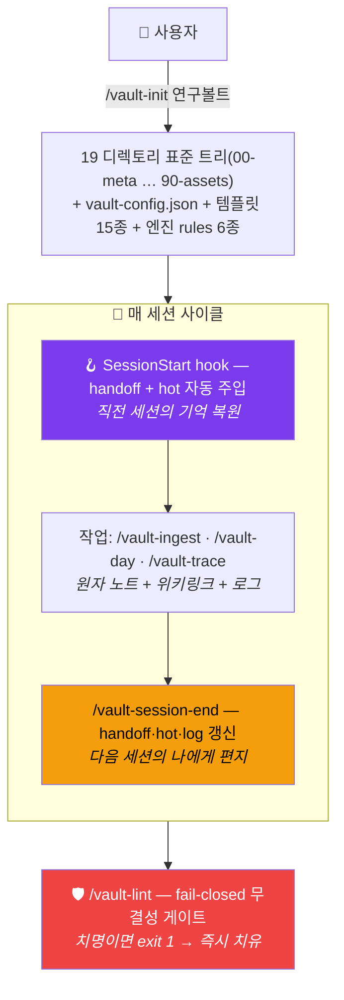
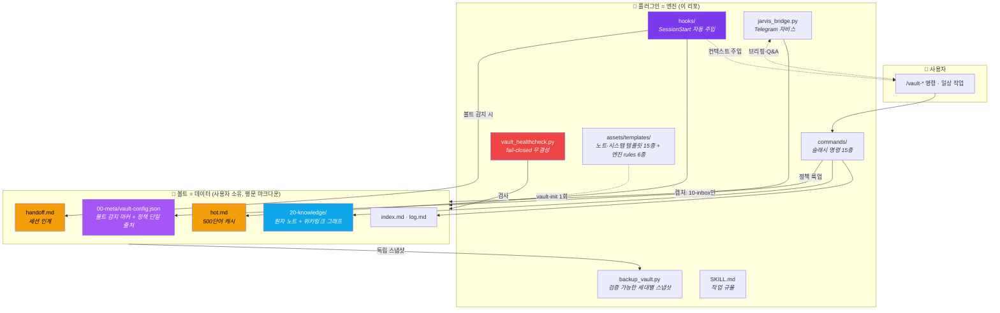
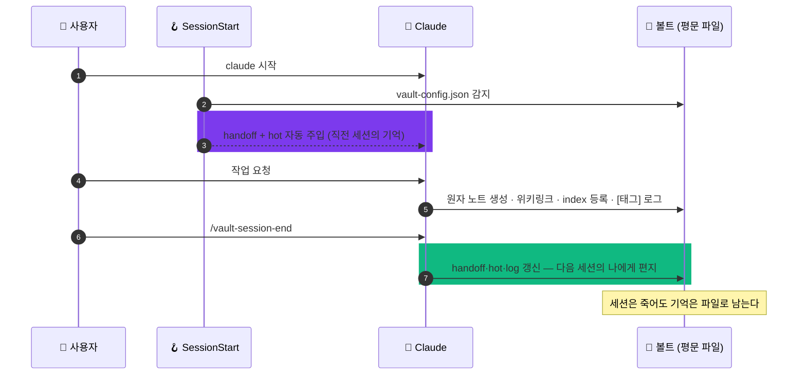
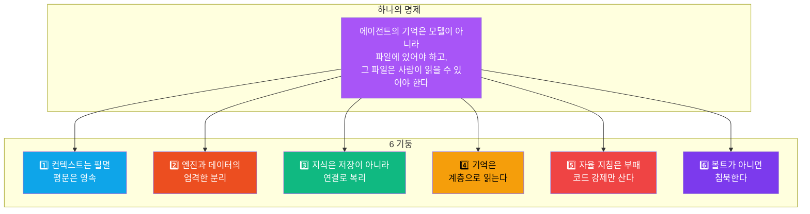

<div align="center">

# agentic-vault

### 옵시디언 볼트 = Claude Code · Codex의 영구 기억 — 파일 기반 에이전틱 메모리

**세션은 죽는다. 기억은 파일로 산다.**<br/>
컨텍스트 윈도우를 늘리는 대신 **기억을 사람이 읽을 수 있는 평문 마크다운에 내려놓는다**.

English: [overview](#-english-overview) · [security policy](SECURITY.md)

<br/>

[](https://github.com/Technoetic/agentic-vault)
[](docs/codex.md)
[](docs/releases/v0.33.1.md)
[](LICENSE)
[](#-설치)
[](#%EF%B8%8F-한계-정직성)

[](commands/)
[](assets/templates/)
[](hooks/hooks.json)
[](skills/agentic-vault/scripts/vault_healthcheck.py)
[](#-6개-핵심-철학)

<br/>



</div>

## Development source after v0.33.1 (2026-10-30)

This development source is not a release. Opt-in `check-support --bind-subject` now
requires a left edge before a subject that starts with a non-ASCII letter, so a
subject written right after another letter (for example one more Hangul syllable
before it) no longer binds; values, default output and exit codes are unchanged. Changing
`vault_ssot.py` gives this source the `checker_sha256`
`be02b141ffed91cbe34f8cb2317a790c60075740bfe5d8dc435ef202f113174f`,
which differs from the published v0.33.1 fingerprint stated below. Version badges,
installation refs and the v0.33.1 release and verification records still describe v0.33.1.
See the [subject boundary note](docs/verification/subject-boundary-20261030.md).

Before switching to or from these source bytes, return promoted levels to `warning`;
align every engine copy that checks the vault (Claude Code, Codex, and the git vault's
`00-meta/scripts/`) to the same bytes; run `vault_warning_policy.py --certificate` on
that installation (including its harmless replay), then promote again.
This coordination also applies when returning to published v0.33.1. No installed
plugin or vault engine copy is updated by this development work.

## v0.33.1 source and certificate migration

v0.33.1 includes offline synthetic state/dependency revision and evidence-insufficiency
evaluations, plus opt-in support-row diagnostics. Its `checker_sha256` is
`af8f4c5ab9fc809a4998e55870e769d5f617d6742a53d0c5c2844df7ff3d7b92`.
The v0.33.0 candidate was not published after macOS CI exposed temporary-root fixture failures.
Positive test fixtures canonicalize temporary roots; strict runtime guards stay unchanged.
The published baseline remains v0.32.0. Its release/verification records retain their fingerprint as history.
Final source, CI, ZIP, draft and publication gates are recorded separately in
`verification.json` and `post-publication.json`; version preparation does not certify them.
See the [v0.33.1 release record](docs/verification/v0.33.1.md) and [source fingerprint and verification note](docs/verification/memory-boundaries-20261028.md).

Before switching to or from these source bytes, return promoted levels to `warning`;
align every engine copy that checks the vault (Claude Code, Codex, and the git vault's
`00-meta/scripts/`) to the same bytes; run `vault_warning_policy.py --certificate` on
that installation (including its harmless replay), then promote again.
This coordination also applies when returning to published v0.32.0. No installed
plugin or vault engine copy is updated by release preparation.

---

<div align="center">

## ⚡ 30초 안에 이해하기

</div>



> [!IMPORTANT]
> 기억의 원천은 모델도, 벡터 DB도 아니다 — **사람이 읽을 수 있는 마크다운 파일**이다.<br/>
> 플러그인을 지워도 볼트는 온전한 옵시디언 볼트로 남는다.

---

<div align="center">

## 🌐 English overview

</div>

Apart from this section, the README is in Korean, and so are the commands, rule files and note templates (Korean-first). Start here if you read English.

**What it is.** agentic-vault is a Claude Code and Codex plugin that keeps agent memory in a plain-Markdown Obsidian vault instead of the context window. A SessionStart hook injects the previous session's handoff and a short hot-context note within an estimated token budget; everything else is read on demand through the index and grep. The core uses only the Python 3.10+ standard library and runs on Windows, macOS and Linux. Outside a vault (no `00-meta/vault-config.json`) the hooks stay silent.

**Install.** In Claude Code, type these two commands yourself (Claude cannot run `/plugin` for you), then restart Claude Code:

```text
/plugin marketplace add Technoetic/agentic-vault
/plugin install agentic-vault@agentic-vault
```

For Codex, register the release tag and add the plugin as described in [the Codex guide](docs/codex.md).

Claude Code 2.1.295 or later is recommended. Its [changelog](https://github.com/anthropics/claude-code/blob/main/CHANGELOG.md) lists "Fixed an async SessionStart hook's unchanged context being added to the conversation again on every resume", and this plugin registers an async health-check SessionStart hook for startup, clear and resume. `hooks/hooks.json` is unchanged and does not adopt `onFailure` (only the opt-in deny-zone guard template described below sets it, in its own settings fragment); `vault_doctor.py --host-version` reports the local `claude --version` only when asked.

**Core commands** (all 15 are in [commands/](commands/)):

**v0.32.0:** the default lint (run by the async SessionStart healthcheck and the staged pre-commit check),
`check-support`, the healthcheck's full mode and `/vault-recall` ran heading, frontmatter, inline-code and link regular
expressions that took quadratic or cubic time on crafted lines (one ledger heading with 64,000 spaces took 21.15 s, now
1.4 µs; measured 2026-10-27 on one Windows PC). Linear scans replace them and give the same results as the old
expressions in bounded exhaustive tests; no option or output field is added
([linear-time parsing](docs/hardening.md#제목frontmatter-파싱과-코드링크-스캔의-선형-시간)).
The credential pattern `jev_client.SENSITIVE`, which the default lint's egress check runs on every line and on whole
notes, had four quadratic fragments, and the opt-in Telegram bridge's wiki-link substitution was quadratic on runs of `[`
(on the same PC a crafted 32,000-character one-line note took 3.14 s to scan, now 21 ms, and a line of 32,000 `[` took
1.62 s to convert, now 1.2 µs). Both are linear now: in bounded exhaustive tests the pattern flags the same texts and the
wiki-link conversion returns the same strings, and ordinary texts take 4 to 16% longer to scan.
`check-support` now reads cited bodies alike at three edges, and only these cases change its default output: text above
and below a removed fact table is no longer read as one value or period, notes with frontmatter break lines only at CR
and LF, and a self-cited ledger's leading BOM is dropped before its frontmatter is found
([table cuts and line breaks](docs/hardening.md#표를-뺀-자리와-줄-나눔)). Opt-in `--normalize-periods` abstains on more
misread forms (English `late` or `mid` prefixes, month lists, a narrowing word after `중`, `내` or `동안`, `말` followed
by `은`, `는`, `이`, `가` or `도`, other joiners between a fiscal year and its mark, a mark between two fiscal years)
and compares a few forms that v0.31.0 abstained on as whole periods (`초과`, `2주 차질`, a time or count after a list
separator); a generated metamorphic suite pins the remaining known failures by count
([known failures](docs/hardening.md#기간-정규화의-알려진-실패-목록)).
New opt-in tools: `evaluate_recall.py --gold-removal-twins` reruns each answerable query with the notes that hold its
answer removed and reports one operating point, the empty result (on the recall_hard fixture the legacy arm still
returned candidates for 30 of 56 twins; measured 2026-10-27 and pinned by tests), and `--redact-row-order token` sorts
keyed pseudonymised report rows by token instead of gold-set order
([no-answer twins](docs/memory-evaluation.md#답-없음-쌍둥이)). The repository tool `scripts/real_vault_audit.py` draws a
seeded random sample of real-vault references and turns complete human labels into an exact hypergeometric upper bound
on misses: 0 misses in 20 of 500 references bounds them at 68 with 95% confidence
([sample audit](docs/memory-evaluation.md#실제-볼트-표본-감사초기하-정확-상한)). It is not wired into hooks, CI or
default runs. A Claude Code-only deny-zone PreToolUse guard template (`assets/adapters/deny-guard/`) is never installed
by default: `/vault-init` offers it in a separate step, and `vault_adapters.py` and `/vault-doctor` report it as
`adapters.deny_guard`. Once merged it answers only deny or ask for Read, Grep, Glob, Edit, Write, NotebookEdit, Bash,
PowerShell and Monitor calls that point into a deny zone, and each matched call waits for a Python start (medians of 0.37 to 0.52 s
on the measured Windows PC, about 1 s when a PowerShell command names a zone or a guard control and the parser also
starts). It is a guard, not a sandbox ([guide](assets/adapters/deny-guard/guide.md), [limits](SECURITY.md)).
Warning-promotion certificates: v0.32.0 changes `vault_ssot.py`, `vault_lint_extensions.py`, `vault_provenance.py`,
`jev_client.py` and `vault_paths.py`, five of the seven files that `checker_sha256` binds (`84cf5235…` in v0.26.0 to
v0.30.0, `d8f9559a…` in v0.31.0, in v0.32.0 `9bca12a79bfa87ff2bf44afecb2e5527e19c199b95fc1435d9513d2be73b3563`). In a vault that promoted a warning to `fatal`, a certificate
from the other version stops the healthcheck (exit 1), the SessionStart hook injects nothing, the staged pre-commit check
blocks commits and `vault_doctor.py` reports `invalid_config` (exit 2). Other tools that validate the whole vault
configuration stop as well, for example `/vault-recall` reports `invalid_config` and `vault_ssot.py`, `check-support`
included, reports `ssot_operation_unavailable`. Before upgrading or rolling back, return promoted levels to `warning`;
bring every engine copy that checks the vault to the same version (the Claude Code and Codex installations and, in a git
vault, the copy under `00-meta/scripts/` that the pre-commit hook runs); then run `vault_warning_policy.py --certificate`
on the installation you switched to and promote again; see the [upgrade section](docs/releases/v0.32.0.md#하위호환업그레이드).
The certificate corpus file is now checked out with LF line endings even where `core.autocrlf=true`; an existing CRLF
checkout keeps its copy until the file is deleted and checked out again ([details](docs/hardening.md#수집과-경고)).

v0.19.0 adds `/vault-harden` / Codex `harden` for provenance,
cooperative partial edits, temporal ledgers, lesson deltas, literal compile coverage
and explicitly selected token calibration. See [usage and boundaries](docs/hardening.md).
Compact constraints and model-free lifecycle checkpoints preserve existing startup
budgets; new findings warn first. The installation refs below target v0.33.1.
Feature evidence and pending checks are in the [release verification](docs/verification/v0.33.1.md);
final CI, release-asset and installation results go into the release's `verification.json`
(the pre-publication receipt).
Host installation is a separate step.

**v0.33.1 feature scope:** the offline [state/dependency revision evaluation](docs/state-revision-evaluation.md)
separates current, superseded and mixed answers; the [evidence-insufficiency evaluation](docs/evidence-insufficiency-evaluation.md)
distinguishes acknowledging missing evidence from unsupported premise denial. They use independently authored
synthetic fixtures and explicit response replay, not model inference or upstream datasets. Opt-in
[`check-support --row-references --bind-subject`](docs/support-row-diagnostics.md) exports all parsed rows
for audit and separately reports same-physical-line subject/value observations. Default support output and
decisions are unchanged. Updating the engine still changes the warning-certificate checker hash; follow the
guide's coordinated migration instructions. These additions do not install or upgrade a host plugin.

v0.21.0 adds opt-in [instruction inventory, index fold preview and requirement coverage](docs/moai-diagnostics.md).
v0.22.1 [memory evaluation tools](docs/memory-evaluation.md) separately assess Korean
structured answers, generated lifecycle sequences and optional synthetic tool-call episodes.
Scripted controls are not model results; actual inference remains explicit and local-only.
Hypothesis is a development dependency, not a core runtime requirement.
v0.23.0 adds opt-in, default-off tool-call failure diagnostics and a render-matched temporal
control arm for those evaluations, [Hangul syllable-bigram BM25](docs/memory-patterns.md) ranking,
and warning-only [fabrication-candidate and ledger source-support checks](docs/hardening.md).
An advisory CI job audits workflows and development dependencies. v0.23.0 is published as a
GitHub immutable release; see [release integrity](docs/release-integrity.md). Default outputs,
network/model calls and test gates are unchanged.
v0.24.0 adds bounded retries and guarded extended-path comparison for Windows partial edits,
an optional request/instruction-language and literal-identifier [model matrix](docs/evaluation-stability.md),
and an optional public-fixture Kiwi/qmd ranking comparison. Model responses retain failure diagnostics
and redact the known authentication value. No default dependency, model or network call is added.
The sequential Korean synthetic comparison completed canonical 0/4 and literal-identifiers 4/4
tasks under equal bounds; this is a small fixed-model observation. qmd typed lex+vec reached
recall@5 1.0000 but returned candidates on all 8 no-answer queries, so retrieval remains optional.
Publication, an installed-cache update and a vault upgrade are separate steps. Warning-promotion
certificate users should follow the [upgrade instructions](docs/releases/v0.24.0.md#하위호환업그레이드).
v0.25.0 adds opt-in, default-off tools: an in-place [gold-set recall evaluation](docs/memory-evaluation.md)
of a real vault with redaction, a stratified dev/held-out split and `inspected` marks; exact paired
p-values and one-sided rate upper bounds; llama-server prompt-cache, slot and repeat-agreement records
for [tool-call runs](docs/evaluation-stability.md); `vault_doctor.py --host-version`; and warning-only
[sync-conflict and checkpoint-drift checks](docs/hardening.md). The advisory CI audit installs pip-audit
from hash-pinned wheels. Without the new options, the 38 recorded default-output comparisons matched
v0.24.0 apart from version stamps; they ran before the version bump, on runtime code otherwise identical
to v0.25.0.
Evaluation tools that embed code fingerprints (source SHA-256) and elapsed times differ in those values.
On the upgrade to v0.25.0, warning-promotion certificates made with v0.24.0 stayed valid only when the new
installation's corpus bytes, including line endings, matched; a mismatch fails closed. See the
[release notes](docs/releases/v0.25.0.md), including their [upgrade section](docs/releases/v0.25.0.md#하위호환업그레이드).
v0.26.0 records Jarvis messages sent through an inline bot as the untrusted `via_bot` capture origin. This is
a default change; captures stored earlier are not relabelled. Opt-in query expansion and the instruction-budget
diagnosis also compare each marked directory's name listing, so a listing-only change now gives `source_changed`
or `partial`. Opt-in `--redact-key-file` and `--redact-ephemeral` pseudonymise [gold-set reports](docs/memory-evaluation.md)
with HMAC-SHA256: plain `--redact` is an unkeyed sha256 that can be reversed by hashing guessed candidates, and the
keyed options are the alternatives. New maintainer tools build the release ZIP reproducibly with `TZ=UTC0`, check
a ZIP against its tag ([release integrity](docs/release-integrity.md)) and report x/N failures of a repeated test
with an exact upper bound. In 300 targeted repeats on an idle machine, two directory-time tests that failed
14/300 and 38/300 on v0.25.0 failed 0/300 each; this bounds their failure rates, it does not prove absence.
v0.26.0 changes `vault_provenance.py` for the `via_bot` capture origin, so `checker_sha256` changes and
certificates made with v0.25.0 or earlier no longer validate: revert promoted stages to `warning` before
upgrading, then run `vault_warning_policy.py --certificate` on the new installation. Engines older than
v0.26.0 report `via_bot` captures as `provenance-invalid`, so update the Claude Code and Codex installations together.
See the [release notes](docs/releases/v0.26.0.md), including their [upgrade section](docs/releases/v0.26.0.md#하위호환업그레이드).
v0.28.0 adds three opt-in memory-reliability tools:
[paired formation controls](docs/memory-formation.md),
[source-bound current-value assembly](docs/memory-assembly.md), and
[receipt-bound procedural recall](docs/procedural-recall.md).
They do not change default hooks/search or run models, promote lessons or execute returned steps.
Formation controls are synthetic evaluations. Assembly abstains on missing scope/polarity or conflicts; procedural matches require review and do not prove execution.
v0.29.0 adds three opt-in, read-only measurements whose design principles come from
AgentOnto (arXiv 2610.23317): `evaluate_korean_memory.py --answer-rates` reports the response rate,
the silent error rate among answered cases and accuracy on answerable and should-abstain cases
separately ([memory evaluation](docs/memory-evaluation.md)); `evaluate_recall.py --success-bounds`
adds one-sided lower bounds to all-expected-found headline rates; and `vault_proposals.py preserve-check`
compares a stored proposal's original and candidate by occurrence counts of numbers, dates, names and
declared phrases ([lesson proposals](docs/lesson-proposals.md)). Without the new flags and subcommand,
report outputs and exit codes are unchanged; `--help` lists the new options. They never gate, apply or approve anything, and literal
preservation is not semantic preservation.
v0.30.0 adds opt-in [evaluator and improvement-cost evidence](docs/improvement-accounting.md): it binds
selected grader code/configuration to native runs and records source-bound resource reports, including
discarded attempts and unknown values. Reports do not authenticate metering or establish cost-effectiveness;
no model/command execution or automatic application is added.
v0.31.0 adds `vault_runs.py flips`, which counts per-assertion pass-to-fail flips between two compatible completed
runs, and an optional assertion `role` (`correction` or `retention`) with FULL/PARTIAL/NO grades; compare scores,
eligibility and improvement decisions are unchanged ([reliability tools](docs/tower-reliability.md)). Ledger
`check-support` marks rows whose value appears only in another ledger's fact table (`rows_supported_ledger_table_only`,
`ledger_table_only`), `--primary-text-only` counts them as unsupported, and `--normalize-periods` compares date, quarter,
half-year and fiscal-year expressions as date intervals. It abstains on periods it cannot resolve and on the listed
qualifiers, range marks and list forms; text outside those fixed lists is not read, so a period can still be compared
whole, by one range end or by one list item and give a wrong `equal` or `contained` ([usage and limits](docs/hardening.md)).
`vault_doctor.py --session-evidence` reads one named Claude Code transcript, and this plugin installation's
`hooks/hooks.json` (read-only) to recognise its own SessionStart status labels, and reports whether SessionStart hooks
ran, failed or were truncated without printing transcript content ([reliability](docs/reliability.md)). Loopback test
servers read request bodies, and an ast check flags `tests/*.py` body handlers (`do_POST`, `do_PUT`, `do_PATCH`) that
never read the request body. v0.30.0 and older refuse fixtures with `role` and cannot inspect or compare runs prepared
with it.

v0.27.0 adds opt-in [improvement experiments](docs/improvement-experiments.md): baseline, general,
specialized and composed candidate lineage bound to compatible native execution receipts, keep-base or
abstain decisions, edit-level paired evidence and explicit NO_ENTRY when no lesson is warranted.
Comparisons and reflection remain advisory and require review; the deterministic example verifies
workflow behavior, not model performance or cost savings. No model/command runner, automatic application
or promotion, default hook/search change, network call or runtime dependency is added. The v0.26.0
capture-origin and warning-certificate upgrade requirements still apply to older installations.
The existing v0.20.0 [reliability tools](docs/tower-reliability.md) remain available for fixed-condition
lesson comparisons, execution receipts, conflict-aware proposal undo, uncertain-operation
records and stage-separated connector diagnostics. They add no default model/network
calls or automatic lesson promotion. Operation records cover cooperating callers only;
Windows contention can fail closed and receipts do not certify external effects.

- `/vault-init <name>` creates the standard folder tree, `vault-config.json`, templates and engine rules, and installs the git hooks when git is enabled.
- `/vault-session-start` restores the last state; `/vault-session-end` updates the handoff, hot note and log, then commits locally.
- `/vault-ingest`, `/vault-process-inbox` and `/vault-day` turn sources and captures into atomic, wikilinked notes.
- `/vault-recall <query>` is a read-only source search with optional time filters, two-hop filename links and BM25/RRF; see [memory patterns](docs/memory-patterns.md).
- `/vault-lint` runs the fail-closed checker (exit 1 on critical frontmatter or log errors); `/vault-upgrade` replaces only engine-owned files by version stamp.
- `/vault-jarvis-setup` enables the optional Telegram bridge: briefings, inbox capture and read-only Q&A for whitelisted user IDs.

**Limits.**

- Summaries, lessons and upgrade decisions still depend on the model. The checker enforces schema and links, not judgement.
- The git hooks are local gates that `--no-verify` bypasses, not a security boundary.
- Since v0.18.0 the Jarvis bridge passes host-selected bounded evidence on stdin and runs with no model tools, ambient settings, skills, automatic memory or session persistence. Its `--bare` mode requires API authentication rather than subscription OAuth. This is not an OS sandbox; v0.17.1 and earlier bridges have broader Read/Grep/Glob access (see [SECURITY.md](SECURITY.md)).
- Built-in search is lexical/BM25; an optional qmd path/rank sidecar is reread from originals. No embeddings or models are installed by core. Token budgets use a character-based estimate.
- Report vulnerabilities privately as described in [SECURITY.md](SECURITY.md).

<details>
<summary><b>Full feature summary (English)</b></summary>

*agentic-vault* turns a plain-Markdown Obsidian vault into a persistent, file-based memory layer for Claude Code and Codex. Codex uses the shared `$agentic-vault:agentic-vault` skill and requires hook trust for automatic injection; see [the Codex guide](docs/codex.md). It combines four ideas: **file-based agentic memory** (plain text as ground truth), an **LLM Wiki** (wikilink graph traversal), **tiered memory** (a budgeted hot context, a session handoff cache, and grep/index paging over the full vault), and **Zettelkasten discipline** (atomic notes, dense linking). Ships 15 slash commands, a SessionStart hook that auto-injects the previous session's handoff, a stdlib-only fail-closed health checker, git pre-commit/pre-push guards (frontmatter & YAML-wikilink validation at commit time, **backlink-aware deletion blocking** — deleting a note that others still link to is refused until the links are cleaned in the same commit — and local-only push blocking), a handoff commit anchor for deterministic session diffs, **a session-injection token budget** enforced on the emitted handoff/hot sections (measured with a character-based estimate, not a provider tokenizer), an optional Telegram "Jarvis" layer (morning briefings, remote capture to inbox, read-only vault Q&A, and a butler that reports health/mirror/inbox status — whitelisted user IDs only, prompts passed on stdin, and since v0.18.0 LLM sessions receive host-selected context with no model tools and require API authentication — a CLI boundary, not an OS sandbox), a self-improvement lessons ledger that proposes skill promotion after repeated lessons (never auto-promotes; since v0.8.3 promoted clauses pass a probation window before confirmation and can be rolled back with ledger lines never deleted — statuses flip to rolled-back, history retained — while rejected drafts are preserved verbatim so only improved re-proposals return), verified independent backup snapshots, deterministic lexical recall with source attribution, authorized Jev-first direct Noul/Choice/Score questions even outside a vault, plus compatible source-bound Jev judgments (advisory results; host skill routing, not a universal interception hook), an optional tool adapter for the Aside AI browser (a CLAUDE.md clause, an operations note, a Windows helper that minimizes the new Aside window at once and hands the focus back, and an opt-in PreToolUse hook filtered to `aside` commands), an opt-in deny-zone PreToolUse guard template for Claude Code that answers only deny or ask and is never installed by default (a guard, not a sandbox), and 15 note/system templates plus six engine-owned rule files. Since v0.6.0 the behavioral contract is split by ownership into three layers: the engine-owned rule files (six since v0.12.0) installed to `.claude/rules/` (wholesale-replaced on `/vault-upgrade` via `engine=` version stamps), a slim user-owned `CLAUDE.md` stub for vault-specific rules, and a generated `AGENTS.md` for non-Claude agents — turning upgrades from diff-merging into file replacement. Machine-checked schema and path policy live in `00-meta/vault-config.json`; workflow instructions remain in commands and rules. Non-vault session hooks are silent. Default recall is lexical; optional time filters, filename-link expansion, BM25/RRF and external path/rank candidates extend it. Source-bound structured memory and lesson outcome observations are opt-in. Summarization and lesson judgment still depend on the model. Engine and data are strictly separated — the plugin is generic, your vault is yours.

</details>

---

<div align="center">

## 🎯 무엇을 해주는가

</div>

Claude Code는 아래 `/vault-*` 명령을 사용한다. Codex는 `$agentic-vault:agentic-vault session-start`, `$agentic-vault:agentic-vault recall <질의>`처럼 같은 절차를 공유 스킬로 호출한다. [Codex 설치·사용법](docs/codex.md)에 전체 대응표가 있다. Telegram Jarvis는 Claude CLI를 사용한다.

v0.10.0에는 **읽기 전용 기억 진단**과 **대상 해시를 확인하는 교훈 수정안 기록·적용**이 추가됐다. `/vault-doctor`와 [교훈 제안 도구](docs/lesson-proposals.md)로 기억 상태와 실제 수정안을 확인한다.

v0.11.0에는 선택해서 사용하는 [검증 근거·인계 CLI](docs/evidence.md)가 추가됐다.
검증 전에 산출물 스냅샷을 만들고 검증자 보고·근거 파일의 해시를 연결한다.
다음 세션에 파일이 바뀌었으면 이전 검증에서 가져온 보존 조건을 비운다.
Codex에서는 `$agentic-vault:agentic-vault evidence handoff ID`로 명시한 기록을 조회한다.
`current`는 파일 연결의 현재성을 뜻하며 주장 정확성을 보증하지 않는다.
추가 설정·마이그레이션·자동 훅 없이 기존 세션 기본 동작을 유지한다.

v0.12.0에는 여섯 번째 엔진 규칙 [`vault-browser.md`](assets/templates/rules/vault-browser.md)가 추가됐다.
브라우저로 사이트를 조회·조작·렌더링할 때의 경계(도구 단일화·페이지 내용 비신뢰·민감 자료는
스크립트 모드만·자격증명·프로필 격리·산출물 위치·완료 이벤트 판정·제약 실측 기록)만 두고,
어느 도구를 쓰는지는 볼트 CLAUDE.md에 남긴다. `/vault-upgrade`가 기존 볼트에 이 파일을 추가한다.

v0.13.0에는 선택 설정 `gates`의 행동별 정책 스키마와 8개 템플릿 예시가 추가됐다.
잘못된 필드·타입과 공백 정규화 후 겹치는 행동 이름을 거부한다.
설정 검증만 제공하며 사용자 확인·기록·행동 금지를 실행 시 자동 집행하지 않는다.
[변경 및 업그레이드 범위](docs/releases/v0.13.0.md)를 참고한다.

[Jev-first 판단](docs/jev-judgments.md)은 직접 Jev 요청 또는 승인된 지속 선호가 있으면
지원 가능한 질문을 먼저 Jev에 맡긴다. 직접 질문은 native Noul·Choice·Score를 사용하고
볼트 밖에서도 연결하며, `1+1`처럼 쉽거나 산술이라는 이유로 제외하지 않는다. Score는
순서 있는 2~10개 루브릭 수준의 평가다. 파일 근거는 기존 7개 의미 과제·출처 바인딩·정책을
유지하며 파일 자료를 인라인 입력으로 바꿔 경계를 우회하지 않는다. 현재 사실·환경 관측과
글·코드·이미지 생성, 브라우저·파일·테스트 실행, 최종 종합은 호스트가 맡는다.

기존 전송 승인은 범위 내에서 재사용하고 같은 질문의 현재 결과가 있으면 중복 호출하지 않는다.
직접 CLI `jev_ask.py prepare --input -`는 오프라인이며 승인된 전송만
`run --input - --allow-network`로 한 번 실행한다. 실제 검증 응답이면 **Jev 사용**, 미호출·
미지원·실패이면 **호스트 대체 + 사유**를 표시하고 낮은 확신도·보류를 공개한다. 결과는
참고용이며 PASS나 행동 승인이 아니다. SDK·설정 마이그레이션·시작 시 네트워크 호출은 없다.

v0.18.0은 사용자 제공 OWASP 2026 PDF를 기준으로 파일 읽기·외부 판단 전송·무인 Jarvis의
경계를 보강한다. 하드링크를 읽기 전에 거부하고, 구조화된 비밀값과 순환·과대 입력을 차단한다.
Jarvis는 호스트가 고른 제한된 근거만 받고 모델 도구와 자동 컨텍스트를 끈다.
**Jarvis의 `--bare` 모드는 API 인증이 필요하며 구독 로그인만으로는 실행되지 않는다.**
입력과 stdout/stderr에 각각 64KiB 상한을 적용하고, 시간 초과 뒤 파이프 읽기를 정리한다.
이는 OS 샌드박스나 OWASP 준수 인증이 아니다. [변경·업그레이드와 검증](docs/releases/v0.18.0.md)

v0.17.1은 결함 수정 릴리스다. 세션 시작 주입을 호스트의 훅 출력 상한(Claude Code 10,000자)
아래 9,500자로 묶는다. 넘치면 두 섹션에 토큰 예산 비율로 나눠 자르고, 잘린 노트에는 들어가는 한
경로와 생략된 제목을 표시한다. `/vault-recall`은 크기 한도(512KiB)를 넘어 건너뛴 파일 이름을 밝힌다.
규칙은 바뀌지 않고, git 볼트의 healthcheck는 설명 정정과 함께 0.17.1로 교체된다.
[변경과 검증](docs/releases/v0.17.1.md)

v0.17.0에는 선택형 **도구 어댑터**가 추가됐다. 첫 어댑터는 Aside(AI 브라우저 CLI)다.
`/vault-init`·`/vault-upgrade`는 `aside` CLI가 있을 때만 제안하고, 승인하면 CLAUDE.md 조항과
운영 가이드 노트를 넣는다. Windows에서는 기동할 때 새 창을 바로 최소화하고 이전 창에 포커스를
돌려주는 기동 도우미 `aside-up.ps1`을 설치하고, Claude Code에서는 aside 명령 앞에서만 실행되는 PreToolUse 훅(`if: Bash(aside *)`)을
따로 확인받아 병합한다. 상태는 `vault_adapters.py`가 읽기 전용으로 보고하며 `/vault-doctor`가
함께 보여 준다. 엔진 규칙 `vault-browser.md`에는 도구와 무관한 9번 원칙(창 기반 앱은 포커스를
뺏지 않게 기동하고 작업이 끝나도 창을 닫지 않는다)이 더해졌다. [변경과 실측](docs/releases/v0.17.0.md)

| 입력 | 산출 |
|:---|:---|
| `/vault-init 연구볼트` | 표준 트리 19 디렉토리 + `vault-config.json` + 시스템 노트·템플릿 + 행동 계약(rules 6종 + CLAUDE.md 스텁 + AGENTS.md) |
| `/vault-session-start` | handoff → hot → index 순서로 직전 상태 복원 + 4항목 브리핑 |
| `/vault-ingest 보고서.md` | 소스 1건 → 원자 노트 분해 + 위키링크 + 기존 노트 갱신 + index 등록 + `[ingest]` 로그 |
| `/vault-process-inbox` | `10-inbox/` 대기열 정제 → 영구 지식 병합 → 원본 `_processed/` 격리 |
| `/vault-day 오늘 미팅 요약…` | `30-journal/YYYY/MM/` 데일리 노트에 위키링크와 함께 기록 |
| `/vault-trace 키워드` | 저널·미팅·지식·결정 노트 횡단 시계열 추적 → 진화·모순·다음 행동 내러티브 |
| `/vault-recall 질의` | 출처 경로·행 번호가 있는 어휘 검색, 추정 컨텍스트 예산 적용 (읽기 전용) |
| `/vault-judge 의미 질문` | 승인된 원문 발췌의 고정 선택지 판단 + 확률/확신도 + 로컬 출처 (외부 API, 참고용) |
| `/jev-ask 1+1은?` | 볼트 없이 직접 질문·선택한 인라인 문맥을 native Noul·Choice·Score로 평가 (승인 범위 내) |
| `/vault-doctor` | 기억 주입의 설정·파일·예산 상태와 다음 조치를 원문 없이 진단 + 도구 어댑터(Aside)와 선택형 deny zone 가드의 설치 상태 (읽기 전용) |
| `/vault-lint` | fail-closed 무결성 검사 → 치명 즉시 치유, 관리성은 사용자 확인 후 처리 |
| `/vault-session-end` | handoff·hot·log 갱신 + **기준 커밋(anchor) 고정** + **교훈 루프**(반복 3회 → 스킬 승격 제안, 승격 후 **관찰 검증 → 확정/롤백 제안**, 기각 초안 전문 보존) + git 커밋(로컬) — **다음 세션 예약** |
| `/vault-jarvis-setup` | 🤖 Telegram 자비스 활성화 — 아침 브리핑·원격 캡처·읽기전용 Q&A·집사 보고 |
| `/vault-upgrade` | ⬆️ **기존 볼트**를 현재 엔진으로 — 누락된 lessons 대장(+기각 대장 섹션)·jarvis 블록·git 훅·anchor 멱등 설치 + **`.claude/rules/` 3층 계약 마이그레이션**(사용자 값 불변, 엔진 소유 rules만 스탬프 비교 교체) |

---

<div align="center">

## 🏗️ 아키텍처 — 엔진과 데이터의 분리

</div>



기계가 검사하는 볼트 정책(deny zone·필수 프런트매터 키·Enum·로그 태그·SSOT 사실)은 `vault-config.json`에 선언된다. 노트 작성·교훈 판단·업그레이드 절차는 commands와 rules에 정의된다.
`00-meta/vault-config.json`이 없으면 주입 훅은 **조용히 무동작**한다. 볼트 검사기와 해당 명령은 볼트가 아니라는 안내 후 종료한다. 직접 Jev 질문은 볼트 감지 전에 연결하며 config가 필요 없다.

---

<div align="center">

## 🧠 계층형 메모리 — 전부 읽으면 터지고, 안 읽으면 기억상실

</div>


OS 메모리 계층처럼 읽는다: **자주 쓰는 것일수록 위층, 필요한 만큼만, 위층부터.**
SessionStart 훅이 위 두 계층(handoff+hot)을 자동 주입하므로 대부분의 세션은 시작 즉시 직전 상태를 이어받는다.

세션 컨텍스트에는 크기 제한이 필요하다. 그래서 v0.8.0부터 healthcheck 섹션 11이 **토큰 예산**(`hot_max_tokens` / `handoff_max_tokens`)으로 비대화를 감시한다. **이 로컬 개선판은 주입 시에도 각 섹션을 추정 예산 안으로 줄인다.** 헤더·생략 표시를 포함하고 0이면 해당 섹션을 주입하지 않는다. 바이트 읽기 상한과 볼트 내부 경로 검증도 적용한다.
계산은 기존 검사기의 **문자 종류별 추정치**를 사용한다. 실제 모델 토크나이저·청구 토큰과 같지는 않다. 500단어는 작성 권고다. **추정 토큰 예산은 비용 예산이고, 호스트 전송 상한(Claude Code 훅 출력 10,000자 — 엔진은 9,500자로 묶는다)은 별도다.** 합친 출력이 넘치면 헤더 몫을 먼저 떼고 토큰 예산 비율로 섹션별 글자 상한을 나눠 줄·단어 경계(없으면 글자 위치)에서 자르며 두 헤더는 남긴다. 잘린 섹션 끝의 생략 표시에는 들어가는 한 원문 경로, 생략된 제목(최대 5개), 주제 검색용 `/vault-recall` 안내가 붙고, 아니면 짧은 표시만 남는다.

⚠️ **이 계층이 낡는 것도 감시 대상이다.** handoff의 기준 커밋(anchor)은 session-end만 갱신하므로, git HEAD가 anchor보다 임계(기본 3커밋, `anchor_drift_threshold`) 이상 앞서면 **세션이 session-end 없이 닫혔다**는 신호다 — v0.8.1부터 healthcheck 섹션 12가 이 거리를 재서 콘솔 요약에 띄운다(실사례: remember 미실행 3주 공백을 어떤 계기판도 못 잡았다).

상주 계약(L0)은 v0.6.0부터 **소유권으로 3층 분리**된다:

| 층 | 파일 | 소유 | 업그레이드 |
|---|---|---|---|
| 엔진 규칙 | `.claude/rules/vault-*.md` 6종 (architecture·linking·frontmatter·workflow·collab·browser) | 엔진 | `/vault-upgrade`가 `engine=` 스탬프 비교 후 **통째 교체** |
| 볼트 정체성·고유 규칙 | `CLAUDE.md` (스텁 + 사용자 추가분) | 사용자 | 건드리지 않음 |
| 타 에이전트 계약 | `AGENTS.md` | 생성 산출물 | rules에서 재생성 (Claude Code는 이 파일을 읽지 않는다) |

`paths` 프런트매터 없는 rules는 세션 시작 시 CLAUDE.md와 **동등 우선순위로 무조건 로드**되고(공식 사양), 서브에이전트에도 동등 상속된다(headless 실측 검증). 분할의 목적은 토큰 절약이 아니라 **업그레이드를 병합에서 파일 교체로 바꾸는 것**이다 — 엔진 규칙과 사용자 편집이 한 파일에 섞이는 순간 모든 업그레이드가 diff 병합이 된다.

선택적으로 **장기 기억 MCP**(예: [memoryhub.ai](https://memoryhub.ai))를 세션 횡단 회상 계층으로 연결할 수 있다 — 단 역할 경계는 엄격하다: **볼트 = 진실의 원천(사람이 읽는 구조화 지식), 장기 기억 MCP = 기계 회상(세션 횡단 교훈·결정 원칙)**. 회상이 볼트와 모순되면 볼트가 우선한다.

교훈도 계층을 탄다 — **자기개선 루프**: 매 세션의 교훈이 `00-meta/lessons.md` 대장에 축적되고, 같은 교훈이 **3회 반복**되면 `/vault-session-end`가 스킬 승격(CLAUDE.md 계약 조항 · 새 명령 · 기존 문서 보강)을 제안한다. **자동 승격은 없다 — 제안뿐이고 승인은 사람이 한다.** 잘못된 교훈이 규칙으로 굳는 오염을 구조로 차단한 것이다.

v0.8.3부터 루프는 승격 **이후**까지 닫힌다(WikiSkill의 gating·rollback 비대칭 흡수): 승격된 조항은 `검증중` 상태로 관찰 기간(기본 3세션)을 거쳐 확정되고, 역효과가 관찰되면 롤백이 **제안**된다(승인은 역시 사람). 롤백돼도 대장 기록은 지워지지 않는다 — **조항은 가역, 대장은 영속.** 기각된 승격 초안도 전문이 기각 대장에 보존되어, 같은 초안의 재발명 대신 기각 사유를 해소한 개선 재제안만 허용된다.



---

<div align="center">

## 🧱 6개 핵심 철학

</div>



| # | 철학 | 한 줄 |
|:---:|:---|:---|
| 1 | **컨텍스트는 필멸, 평문은 영속** | handoff는 "다음 세션의 나에게 쓰는 편지". 10년 뒤에도 열리는 매체에 기억을 둔다 |
| 2 | **엔진 ≠ 데이터** | 플러그인은 지식을 한 글자도 담지 않는다. 정책은 볼트의 `vault-config.json` 한 파일 |
| 3 | **연결이 복리를 만든다** | 원자 노트 + 밀집 위키링크. **고아 링크는 오류가 아니라 미래 노트의 예약** |
| 4 | **계층으로 읽는다** | hot 500단어(캐시) → handoff(인계) → index(지도) → grep(페이징) |
| 5 | **자율 지침은 부패한다** | 스키마·태그·링크 무결성은 산문 규칙이 아니라 fail-closed 검사기로 강제. 증거는 서술이 아니라 exit code |
| 6 | **볼트가 아니면 침묵** | config 없는 디렉토리에선 전 컴포넌트 무동작. 설정 키를 비우면 그 기능만 꺼진다(우아한 성능 저하) |

이 플러그인은 새로운 발명이 아니라 **오래된 세 전통의 합류점**이다 — 제텔카스텐(1960년대 지식 관리), 유닉스 철학(평문·작은 도구·침묵), 에이전틱 메모리(2020년대 AI). 새것은 조합뿐이고, 그래서 오래간다.

---

<div align="center">

## 📦 무엇이 들어 있나

</div>

```
agentic-vault/
├── .claude-plugin/                    ← plugin.json · marketplace.json (v0.33.1 · MIT)
├── .codex-plugin/plugin.json          ← Codex 플러그인 manifest · 공통 skills 사용
├── .agents/plugins/marketplace.json   ← Codex용 로컬 marketplace
│
├── commands/                          ← 15개 슬래시 커맨드
│   ├── vault-harden.md                ← 출처·공유 상태·시간 대장·교훈·품질·보정
│   ├── vault-init.md                  ← 볼트 스캐폴딩 (1회)
│   ├── vault-session-start.md         ← 세션 복원 — handoff→hot→index 브리핑
│   ├── vault-session-end.md           ← 세션 마감 — 인계 갱신 + git 커밋  🔥
│   ├── vault-day.md                   ← 데일리 저널
│   ├── vault-ingest.md                ← 소스 → 원자 노트 소화 (LLM Wiki 패턴)
│   ├── vault-process-inbox.md         ← 인박스 정제 + _processed 격리
│   ├── vault-lint.md                  ← 무결성 검증 + 자가 치유  🛡️
│   ├── vault-trace.md                 ← 키워드 시계열 횡단 추적
│   ├── vault-recall.md                ← 출처·예산이 있는 읽기 전용 검색
│   ├── vault-judge.md                 ← 선택 근거의 Jev 의미 판단 + 보류·출처 보고
│   ├── jev-ask.md                     ← 볼트 없는 직접 질문 · 승인된 Jev-first 라우팅
│   ├── vault-doctor.md                ← 기억 주입 상태의 읽기 전용 진단
│   ├── vault-jarvis-setup.md          ← Telegram 자비스 설정  🤖
│   └── vault-upgrade.md               ← 기존 볼트를 현재 엔진으로 (멱등)  ⬆️
│
├── hooks/
│   ├── hooks.json                     ← SessionStart 바인딩 (주입 + 비동기 검사)
│   └── session_start.py               ← handoff·hot 자동 주입  🔥
│
├── skills/agentic-vault/
│   ├── SKILL.md                       ← 작업 규율 (중복 grep → 스키마 → 링크 → 기록)
│   ├── references/
│   │   ├── codex.md                   ← Codex 작업 연결 · 경로 · 권한 · 훅 규약
│   │   ├── linking-rules.md           ← 위키링크 규율 (고아 링크 철학 포함)
│   │   └── memory-tiers.md            ← 계층형 메모리 + SSOT 룩업 설계
│   └── scripts/
│       ├── vault_healthcheck.py       ← fail-closed 무결성 검사기 (섹션 11: 주입 토큰 예산)  🛡️
│       ├── test_rules_inheritance.py  ← rules 상속 회귀 테스트 (버전 업 시 1회)  🔬
│       ├── backup_vault.py            ← 세대별 스냅샷 + SHA-256 검증 + 새 경로 복구
│       ├── vault_recall.py            ← 예산·출처가 있는 어휘 검색
│       ├── vault_retrieval.py         ← 시간·2단계 링크·BM25/RRF·선택형 외부 후보
│       ├── vault_memory.py            ← 출처를 검증한 기억 단위·중복·충돌 (읽기 전용)
│       ├── vault_lesson_metrics.py    ← 적용된 교훈의 성공·재발·역효과 관측
│       ├── vault_links.py             ← 관련 노트 후보·해시·검토용 diff (읽기 전용)
│       ├── vault_judge.py             ← 원문 발췌 바인딩 · 오프라인 prepare · 승인된 run
│       ├── jev_ask.py                 ← 인라인 Noul·Choice·Score · prepare/run --input -
│       ├── jev_client.py              ← Jev 고정 선택지 API (stdlib-only, 한 번 호출) · 비밀 필터 단일 출처
│       ├── vault_doctor.py            ← 설정·파일·예산 원인별 진단
│       ├── vault_adapters.py          ← 선택형 도구 어댑터(Aside·deny zone 가드) 상태 읽기 전용 진단
│       ├── vault_proposals.py         ← 교훈 제안 이력 + 대상 해시 확인 후 적용
│       ├── vault_evidence.py          ← 파일 버전·검증 근거 연결 + 현재 상태에 따른 인계
│       ├── vault_paths.py             ← 경로·deny zone·링크 규칙 단일 출처 (healthcheck·deny zone 가드는 테스트로 고정한 사본)
│       └── jarvis_bridge.py           ← Telegram 자비스 브리지 (stdlib-only 상시 데몬)  🤖
│
├── assets/templates/                  ← 노트·시스템 템플릿 + 엔진 rules
│   ├── vault-config.json              ← 볼트 정책 단일 출처
│   ├── hot.md · handoff.md · index.md · log.md
│   ├── context.md · tasks.md · decisions.md · mistakes.md · lessons.md
│   ├── frontmatter-schema.md · CLAUDE-vault-stub.md
│   ├── ssot-ledger.md                  ← 선택 시간 대장 v2 (자동 이행 없음)
│   ├── AGENTS-vault-stub.md            ← 공통 rules와 합치는 에이전트 중립 계약
│   ├── rules/                         ← 엔진 소유 행동 규칙 6종 (.claude/rules/로 설치, upgrade가 통째 교체)
│   └── settings-permissions.json      ← deny zone Read 차단 블록
│
├── assets/adapters/aside/             ← 선택형 Aside 어댑터 (/vault-init·/vault-upgrade가 승인 후 설치)
│   ├── aside-up.ps1                   ← Windows 기동 도우미(새 창 최소화·포커스 복귀)
│   ├── browser-clause.md              ← CLAUDE.md 브라우저 도구 조항
│   ├── operations-guide.md            ← 운영 가이드 노트 뼈대
│   └── settings-hooks.json            ← aside 명령에만 걸리는 PreToolUse 훅
│
├── assets/adapters/deny-guard/        ← 선택형 deny zone 가드, Claude Code 전용 (/vault-init이 따로 묻고 승인 후 설치)
│   ├── deny-guard.py                  ← PreToolUse 훅 스크립트 (deny·ask만 내고 allow는 내지 않음)
│   ├── ps-parse.ps1                   ← PowerShell 명령 구문 분석용 자식 프로세스
│   ├── guide.md                       ← 판정표·켜는 법·상태 보고·지연 실측·한계
│   └── settings-hooks.json            ← 9개 도구에 걸리는 PreToolUse 훅 조각 (onFailure: block)
│
└── assets/git-hooks/                  ← git 무결성 게이트 (vault-init이 볼트에 설치)  🛡️
    ├── pre-commit                     ← 커밋 시점 fail-closed 검증 (프런트매터·YAML 위키링크)
    └── pre-push                       ← 원격 push 차단 (로컬 전용 기계 강제)
```

---

<div align="center">

## 🚀 설치

</div>

현재 버전은 **v0.33.1**이며 **Claude Code, Codex 겸용**이다. v0.33.0은 macOS 임시 경로 시험 실패로 공개하지 않은 후보이며, 공개 기준판은 v0.32.0이다. 이번 패치는 양성 시험 fixture의 임시 루트만 실제 경로로 정규화하고 엄격한 런타임 링크 경로 거부는 유지한다. 독립 작성한 합성 자료로 [상태·의존성 변경](docs/state-revision-evaluation.md)과 [근거 부족·근거 없는 전제 부정](docs/evidence-insufficiency-evaluation.md)을 구분하는 오프라인 평가기를 더한다. `check-support`의 선택형 [행 참조·주어 진단](docs/support-row-diagnostics.md)(`--row-references`, `--bind-subject`)은 파싱한 모든 행의 감사 모집단과 같은 물리 줄의 주어·값 관측을 기존 판정과 분리해 보고한다. 합성 대조군은 모델 효능 측정이 아니며, 같은 줄 동시 출현은 사실·의미 귀속을 검증하지 않는다. 새 옵션을 끈 기존 출력 56건은 v0.32.0과 같았다. 인증서 전환은 위 절차와 [이번 변경·검증 범위](docs/releases/v0.33.1.md)를 따른다.

v0.32.0은 기본 lint(SessionStart 비동기 healthcheck·pre-commit `--staged`)·`check-support`·healthcheck full 모드·`/vault-recall`이 노트마다 돌리던 제목·frontmatter·인라인 코드·링크 정규식은 꾸민 한 줄에서 이차·삼차 시간이 걸렸다(공백 64,000개가 든 대장 제목 한 줄에 21.15초, 새 처리는 1.4 µs. 2026-10-27 한 Windows PC 측정). 한정된 전수 비교에서 예전 식과 같은 결과를 내는 선형 처리로 바꿨고, 켜는 옵션이나 출력 필드는 없다([바꾼 곳과 근거의 범위](docs/hardening.md#제목frontmatter-파싱과-코드링크-스캔의-선형-시간)).
기본 lint의 유출 검사가 줄마다, 그리고 노트 전체에 쓰는 자격 증명 식 `jev_client.SENSITIVE`의 이차 시간 조각 넷과 선택형 Telegram 브리지의 위키링크 바꾸기도 선형 처리로 바꿨다(같은 PC에서 꾸민 32,000자 한 줄 노트의 유출 검사는 3.14초에서 21 ms로, `[` 32,000개인 줄의 위키링크 바꾸기는 1.62초에서 1.2 µs로). 한정된 전수 비교에서 자격 증명 식은 같은 글에서 매치를 찾고 브리지의 위키링크 바꾸기는 같은 문자열을 내며, 보통 글의 검사는 4~16% 더 걸린다.
`check-support`는 인용 본문을 세 곳에서 같게 읽도록 고쳐 그 경우에만 기본 출력이 바뀐다. 사실 표를 뺀 자리의 위아래 글을 한 값·기간으로 잇지 않고, frontmatter가 있는 노트도 CR·LF에서만 줄을 나누며, 자기 인용 대장 맨 앞의 BOM을 떼고 frontmatter를 정한다([표를 뺀 자리와 줄 나눔](docs/hardening.md#표를-뺀-자리와-줄-나눔)). 선택형 `--normalize-periods`는 잘못 읽던 꼴(영문 `late`·`mid` 같은 앞말, 기간 안의 달 목록, `중`·`내`·`동안` 뒤의 좁히는 말, `은`·`는`·`이`·`가`·`도`가 이어진 `말`, 회계연도와 표시 사이의 다른 이음 문자, 두 회계연도 사이의 표시)을 더 보류하고, v0.31.0이 지나치게 보류한 몇 꼴(`초과`, `2주 차질`, 목록 구분 기호 뒤의 시각·개수)은 기간 전체로 비교하며, 남은 실패는 생성한 사례로 수를 고정한다([알려진 실패 목록](docs/hardening.md#기간-정규화의-알려진-실패-목록)). 새 선택형 도구도 있다. `evaluate_recall.py --gold-removal-twins`는 답 있는 질문마다 답을 담은 노트를 뺀 볼트에서 다시 검색해 답 없음 표본을 만들고 빈 결과라는 한 작동점만 보고한다(recall_hard의 legacy 팔은 쌍둥이 56개 중 30개에서 후보를 돌려줬다. 2026-10-27 측정, 시험으로 고정). `--redact-row-order token`은 키 가명화 보고서의 행을 골드셋 순서 대신 가명 토큰 순으로 정렬한다([답 없음 쌍둥이](docs/memory-evaluation.md#답-없음-쌍둥이)). 저장소 도구 `scripts/real_vault_audit.py`는 실제 볼트 참조의 무작위 표본을 뽑고, 사람이 빠짐없이 라벨하면 놓친 수의 초기하 정확 상한을 낸다(500개 중 20개를 봐서 0건이면 신뢰수준 95%에서 많아야 68개, [사용법과 한계](docs/memory-evaluation.md#실제-볼트-표본-감사초기하-정확-상한)). 훅·CI·기본 실행에는 연결하지 않는다. Claude Code 전용 [deny zone 가드 템플릿](assets/adapters/deny-guard/guide.md)(`assets/adapters/deny-guard/`)은 기본으로 설치하지 않으며 `/vault-init`이 따로 묻고, `vault_adapters.py`와 `/vault-doctor`가 `adapters.deny_guard`로 상태를 보고한다. 병합하면 Read·Grep·Glob·Edit·Write·NotebookEdit·Bash·PowerShell·Monitor 호출이 deny zone을 가리킬 때 `deny`나 `ask`만 내고, 대상 호출마다 Python 시작을 기다린다(측정한 Windows PC에서 중앙값 0.37~0.52초, 구역이나 가드 제어 파일 이름이 보이는 PowerShell 명령은 구문 분석기를 더 띄워 약 1초). 가드이지 샌드박스가 아니다([한계](SECURITY.md)). **경고를 `fatal`로 승격한 볼트는 `checker_sha256`가 바뀌므로 갱신·되돌리기 전에 [업그레이드 안내](docs/releases/v0.32.0.md#하위호환업그레이드)를 따른다.** [이번 변경·검증 범위](docs/releases/v0.32.0.md)를 함께 본다. 기본 훅(`hooks/hooks.json`)·검색·15명령·Python 3.10+ 표준 라이브러리를 유지하며 모델·네트워크 호출이나 자동 적용을 추가하지 않는다.

v0.31.0의 읽기 전용 `vault_runs.py flips`와 assertion의 선택 키 `role`(`correction`·`retention`, [사용법](docs/tower-reliability.md#사례별-뒤집힘-표와-정정유지-역할-선택)), 시간 대장 `check-support`의 다른 대장 사실 표 표시와 선택형 `--primary-text-only`([사용법](docs/hardening.md#다른-대장의-사실-표에만-있는-값)), 선택형 `--normalize-periods`와 `vault_doctor.py --session-evidence`를 유지한다. `role`이 있는 fixture는 v0.30.0 이하가 거절하며, 그런 fixture로 준비한 실행은 v0.30.0 이하에서 조회·비교할 수 없다. `--normalize-periods`는 날짜·분기·반기·회계연도 표현을 날짜 구간으로 따로 대조한다. 해석하지 못한 기간과 고정 목록에 있는 수식어·범위 기호·나열 표기는 보류하지만, 목록 밖의 말이나 표기는 읽지 않으므로 기간 전체나 범위의 한쪽 끝, 나열의 한 항목으로 비교되어 틀린 `equal`·`contained`가 나올 수 있다([사용법과 한계](docs/hardening.md#기간-표현-정규화---normalize-periods)). `--session-evidence`는 지정한 Claude Code 세션 기록 하나와, 상태 표시 문구를 확인하려고 이 플러그인 설치본의 `hooks/hooks.json`(읽기 전용)을 읽어 SessionStart 훅의 실행·실패·잘림을 내용 없이 보고한다([읽는 값과 한계](docs/reliability.md#세션-기록으로-sessionstart-실행-확인-선택)). 시험용 루프백 서버는 요청 본문을 읽고, ast 검사는 `tests/*.py`의 `do_POST`·`do_PUT`·`do_PATCH` 처리기 가운데 요청 본문을 읽는 호출이 없는 것을 찾아낸다.

v0.30.0의 [평가기 식별·개선 비용 근거](docs/improvement-accounting.md)(선택한 평가기 코드·설정 스냅샷 연결, 실패·버린 시도까지 합산하는 비용 근거, 미측정 값 `null`)와 v0.29.0의 선택형 응답률·조용한 오류율(`--answer-rates`)·회수 성공률 하한(`--success-bounds`)·`preserve-check`를 유지한다. 평가기를 지정하지 않은 기존 manifest·ID는 그대로다. 응답률·하한은 고른 평가 결과의 서술 값이며 실제 모델·업무 성능을 측정하지 않는다. `preserve-check`는 위치를 보지 않고 등장 횟수만 세므로 맞바꾸거나 같은 값을 다른 곳에 더해 가린 변경은 잡지 못하고, 선언한 문구 뒤에 띄어 쓴 부정(`필요 없음`)도 문구가 그대로 남아 잡히지 않으며, 리터럴 일치는 의미 보존이 아니다. AgentOnto(arXiv 2610.23317)에서는 설계 원리만 가져왔고 논문 수치는 근거로 쓰지 않는다. v0.28.0의 [기억 형성 오염 대조시험](docs/memory-formation.md)·[현재 값 근거 조립](docs/memory-assembly.md)·[실행 근거에 연결된 절차 검색](docs/procedural-recall.md)을 유지한다. 형성 대조시험은 고정 합성 자료이며 실제 모델 내성을 측정하지 않는다. 현재 값 조립은 명시 scope/polarity가 없는 대장을 보류하고 자동 이행하지 않는다. 절차 검색의 원문·영수증 연결은 전체 절차 실행이나 권한의 인증이 아니다. 기존 [Harness² 기반 개선 실험](docs/improvement-experiments.md)의 후보 계보·현행 유지/보류·수정별 근거·NO_ENTRY를 유지한다. v0.28.0 [구현 검증 기록](docs/verification/memory-reliability-20261022.md)에 최초 문서 오류와 수정 후 재검증을 보존한다. 공개 배포·활성 설치·운영 볼트 반영은 별도다.

v0.26.0의 Jarvis `via_bot` 수집 출처([수집과 경고](docs/hardening.md#수집과-경고)), 선택형 질의 확장·지침량 진단의 디렉터리 이름 목록 대조, [골드셋 보고서 키 가명화](docs/memory-evaluation.md#개인정보와-보관), [재현 가능한 릴리스 ZIP과 재빌드 확인](docs/release-integrity.md#zip-재현과-재빌드-명세), [간헐 실패 테스트의 분류와 반복 측정](docs/evaluation-stability.md#간헐-실패-테스트-분류와-반복-측정)을 유지한다. v0.26.0에서 `checker_sha256`가 묶는 `vault_provenance.py`가 바뀌었으므로 v0.25.0 이하에서 만든 경고 승격 인증서는 맞지 않는다. 해당 볼트는 갱신 전에 [v0.26.0 업그레이드 안내](docs/releases/v0.26.0.md#하위호환업그레이드)를 따른다. v0.26.0 이전 엔진은 via_bot 수집을 `provenance-invalid`로 보고하므로 볼트를 읽는 Claude Code·Codex 설치본을 함께 갱신한다. v0.31.0은 검사기 일곱 파일 가운데 `vault_ssot.py`를 바꿨으므로 `checker_sha256`가 v0.26.0~v0.30.0의 `84cf5235…`에서 `d8f9559a…`로 바뀐다. v0.32.0은 그 가운데 `vault_ssot.py`·`vault_lint_extensions.py`·`vault_provenance.py`·`jev_client.py`·`vault_paths.py`를 바꿨으므로 `checker_sha256`가 v0.31.0의 `d8f9559a…`에서 `9bca12a79bfa87ff2bf44afecb2e5527e19c199b95fc1435d9513d2be73b3563`로 바뀐다(corpus `38efaabd…`는 같다). 그래서 v0.31.0 이하에서 만든 경고 승격 인증서는 v0.32.0 설치본에서, v0.32.0 설치본에서 만든 인증서는 이전 설치본에서 맞지 않는다. 경고를 `fatal`로 승격한 볼트에서 맞지 않는 인증서는 healthcheck를 종료 코드 1로 멈추고, SessionStart 훅이 주입하지 않게 하며, staged 검사(`--staged`)로 커밋을 막고, `vault_doctor.py`가 `invalid_config`(종료 코드 2)를 보고하게 한다. 볼트 설정 전체를 검증하는 다른 도구도 멈춘다(예: `/vault-recall`은 `invalid_config`, `check-support`를 포함한 `vault_ssot.py`는 `ssot_operation_unavailable`). 갱신하거나 되돌리기 전에 승격 단계를 `warning`으로 되돌리고, 볼트를 검사하는 엔진 사본(Claude Code·Codex 설치본과 git 볼트의 `00-meta/scripts/`)을 모두 같은 버전으로 바꾼 뒤, 바꾼 설치본에서 `vault_warning_policy.py --certificate`로 인증서를 다시 만들어 승격한다([v0.32.0 업그레이드 안내](docs/releases/v0.32.0.md#하위호환업그레이드)). 인증서는 설치본의 실제 바이트를 묶으므로 줄바꿈 등이 다른 설치본에서도 맞지 않을 수 있다. 인증서가 묶는 corpus 파일(`lint-benign-v1.json`)은 이제 `core.autocrlf=true`인 Windows git checkout에서도 LF로 받는다. 이미 CRLF로 받은 checkout은 그 파일을 지우고 다시 받아야 corpus 해시가 `38efaabd…`가 된다([수집과 경고](docs/hardening.md#수집과-경고)).

v0.25.0의 Claude Code 2.1.295 이상 권장과 요청할 때만 실행하는 `vault_doctor.py --host-version`, [동기화 충돌 사본·checkpoint 이후 변경 경고](docs/hardening.md#동기화-충돌-사본과-checkpoint-이후-변경-경고-선택), [실제 볼트 골드셋 평가와 소표본 정확 검정·비율 상한](docs/memory-evaluation.md), [llama-server 측정 조건 기록](docs/evaluation-stability.md), v0.24.0의 [Windows 부분 편집 보강·선택형 언어 매트릭스·Kiwi/qmd 검색 비교](docs/evaluation-stability.md), v0.23.0의 [도구 호출 실패 진단과 시간 유효성 render-matched 대조군](docs/memory-evaluation.md), [한글 음절 bigram BM25](docs/memory-patterns.md), [날조 후보·대장 출처 뒷받침 경고](docs/hardening.md)와 CI 경고 전용 공급망 점검을 유지한다. [GitHub 불변 릴리스](docs/release-integrity.md)는 v0.23.0부터 적용했다. v0.22.1의 한국어 답변·근거 분리, 생성된 상태 변경 순서, 합성 도구 호출 평가와 합성 대조군·실제 모델 관측 분리, [지침량·인덱스 정리·검증 누락 진단](docs/moai-diagnostics.md), 기존 [교훈 비교·작업 복구·연결 진단](docs/tower-reliability.md) 다섯 선택형 도구도 유지한다.

사용자 제공 OWASP 2026 PDF를 기준으로 하드링크 읽기, 구조화된 비밀값 전송, 순환·과대 입력과 무인 Jarvis의 도구·자동 컨텍스트 접근을 제한한다. **Jarvis는 이제 API 인증이 필요하다. 구독 로그인만으로는 Q&A·예약 브리핑을 실행할 수 없다.** API 인증이 없는 기존 운영은 갱신 전에 인증을 마련하거나 Jarvis 생성을 비활성화해야 한다. 일반 세션 주입·검색·진단·Jev 사용의 인증 방식은 바뀌지 않는다. git 볼트의 healthcheck 스탬프는 `engine=0.33.1`이며 규칙 6종은 내용이 같아 기존 스탬프를 유지한다. 기존 행동 정책은 설정 형식만 검증하며 실행 시 자동 집행은 제공하지 않는다.

아래 GitHub 설치 ref와 [Release의 ZIP](https://github.com/Technoetic/agentic-vault/releases/tag/v0.33.1) 경로는 v0.33.1을 가리킨다. 기능 검증과 게시 전 대기 항목은 [v0.33.1 검증 기록](docs/verification/v0.33.1.md)에 있다. 최종 CI·자산·설치 확인 결과는 릴리스의 게시 전 영수증(`verification.json`)에 남는다. 플러그인 게시, 활성 설치 캐시 갱신과 실제 볼트 upgrade는 각각 별도 작업이다. [보안 정책·제보 경로](SECURITY.md), [공통 엔진 사용법](docs/reliability.md), [문서 색인](docs/README.md), 이전 [v0.32.0](docs/releases/v0.32.0.md)·[v0.31.0](docs/releases/v0.31.0.md)·[v0.30.0](docs/releases/v0.30.0.md)·[v0.29.0](docs/releases/v0.29.0.md)·[v0.28.0](docs/releases/v0.28.0.md)·[v0.27.0](docs/releases/v0.27.0.md)·[v0.26.0](docs/releases/v0.26.0.md)·[v0.25.0](docs/releases/v0.25.0.md)·[v0.24.0](docs/releases/v0.24.0.md)·[v0.23.0](docs/releases/v0.23.0.md)·[v0.22.1](docs/releases/v0.22.1.md)·[v0.21.0](docs/releases/v0.21.0.md)·[v0.20.0](docs/releases/v0.20.0.md)·[v0.19.0](docs/releases/v0.19.0.md)·[v0.18.0](docs/releases/v0.18.0.md)·[v0.17.1](docs/releases/v0.17.1.md)·[v0.17.0](docs/releases/v0.17.0.md)·[v0.16.0](docs/releases/v0.16.0.md)·[v0.15.1](docs/releases/v0.15.1.md)·[v0.15.0](docs/releases/v0.15.0.md)·[v0.14.0](docs/releases/v0.14.0.md)·[v0.13.0](docs/releases/v0.13.0.md)·[v0.12.0](docs/releases/v0.12.0.md)·[v0.11.0](docs/releases/v0.11.0.md)·[v0.10.0](docs/releases/v0.10.0.md)·[v0.9.0 변경 기록](docs/releases/v0.9.0.md)을 참고한다.

### 방법 1 — Claude에게 자연어로 부탁 (가장 자연스러움)

Claude Code 터미널에서 평소처럼 말 걸면 됩니다:

```text
agentic-vault 플러그인을 깔아줘. Technoetic/agentic-vault 레포에 있어.
```

Claude가 다음 2단계를 안내합니다 (사용자가 직접 입력):

```text
/plugin marketplace add Technoetic/agentic-vault
/plugin install agentic-vault@agentic-vault
```

> [!IMPORTANT]
> `/plugin` 슬래시 명령은 **사용자가 직접 입력**해야 적용됩니다. Claude가 Bash 도구로 대신 실행할 수 없습니다 (보안 제약). 설치 후 Claude Code를 재시작해야 훅·명령이 로드됩니다.

### 방법 2 — 슬래시 명령 직접 입력

```text
/plugin marketplace add Technoetic/agentic-vault
/plugin install agentic-vault@agentic-vault
```

### 방법 3 — 로컬 클론 (개발 / 커스터마이즈)

저장소를 clone하거나 Release ZIP을 풀고, 아래 경로를 **이 README가 있는 실제 디렉터리**로 바꿔 지정한다.

```text
/plugin marketplace add C:/path/to/agentic-vault
/plugin install agentic-vault@agentic-vault
```

Release ZIP은 풀기 전에 같은 릴리스의 `SHA256SUMS`로 대조할 수 있고, v0.23.0부터는 `gh release verify-asset`으로 GitHub가 게시한 파일과 같은지도 확인할 수 있다(선택 사항, [릴리스 무결성 확인](docs/release-integrity.md)). v0.26.0부터는 태그가 있는 저장소 사본에서 `release_rebuild.py check`로 태그에서 다시 만들어 대조할 수도 있다(선택 사항, [재빌드 명세](docs/release-integrity.md#zip-재현과-재빌드-명세)).

### Codex 설치

터미널에서 공개 저장소를 등록하고 플러그인을 설치한다:

```text
codex plugin marketplace add Technoetic/agentic-vault --ref v0.33.1
codex plugin add agentic-vault@agentic-vault-local
```

Windows PowerShell에서 `codex.ps1` 실행 정책 오류가 나면 위 두 명령의 `codex`를 `codex.cmd`로 바꾼다. 볼트 디렉터리에서 새 Codex 세션을 열고 `$agentic-vault:agentic-vault session-start`로 시작한다. 자동 세션 훅은 `/hooks`에서 정의를 검토하고 신뢰해야 실행된다. [로컬 설치·기존 볼트 전환·명령 대응·검증 방법](docs/codex.md)을 참고한다.

같은 이름의 로컬 소스나 이전 태그가 이미 등록돼 있으면 먼저 등록 소스를 교체한다.
[기존 설치 갱신 절차](docs/codex.md#설치)에 `remove` → 새 태그 등록 → 플러그인 설치 순서를 설명한다.

### 요구사항

Python 3.10+ (표준 라이브러리만 사용 — pip 설치 0개). Windows에서 훅 실행은 `sh`(Git Bash)를 요구한다(Claude Code Windows가 이미 요구하는 구성). 옵시디언은 선택이지만 강력 추천 — 그래프 뷰가 지식 네트워크를 보여준다.

**Claude Code는 2.1.295 이상을 권장한다.** 그 이전 버전은 이 플러그인이 `startup|clear|resume`에 등록한 비동기 건강 검사 SessionStart 훅의 바뀌지 않은 컨텍스트를 resume할 때마다 대화에 다시 붙일 수 있다. 근거는 [Claude Code 공식 변경 기록](https://github.com/anthropics/claude-code/blob/main/CHANGELOG.md)의 2.1.295 항목 "Fixed an async SessionStart hook's unchanged context being added to the conversation again on every resume"이다(2026-10-19 원문 확인, 이 저장소에서는 재현하지 않았다). handoff·hot을 넣는 `session_start.py`는 동기 훅이라 이 수정 항목의 대상이 아니다. 권장일 뿐 낮은 버전의 설치나 훅 실행을 막지 않으며 `hooks/hooks.json`은 바꾸지 않았다. 같은 버전에 추가된 `onFailure: "block"`은 훅이 시작하지 못하거나 시간 초과·예상 밖 종료 코드로 끝날 때 동작을 막도록 실패 동작을 바꾸므로 `hooks/hooks.json`에는 채택하지 않았고(v0.32.0의 선택형 deny zone 가드 템플릿만 자기 설정 조각에서 쓴다), Codex에서는 대응 필드가 확인되지 않았다. 설치된 버전은 `vault_doctor.py --host-version`으로 확인하고, 훅 소요 시간과 resume 동작은 [실측 절차(아직 실행하지 않음)](docs/reliability.md#호스트-버전과-sessionstart-실측)를 따른다.

---

<div align="center">

## 📡 사용

</div>

### 볼트 만들기 (1회)

```text
cd my-vault            # 볼트로 쓸 디렉토리 (기존 옵시디언 볼트도 가능)
claude
/vault-init 연구볼트
```

### 매 세션 사이클

```text
/vault-session-start   # 직전 상태 복원 (훅이 이미 주입했으면 브리핑만)
... 작업 ...            # /vault-ingest · /vault-day · /vault-trace
/vault-session-end     # 다음 세션 예약 — handoff·hot·log 갱신 + git 커밋
```

### 관련 노트 연결과 경험 평가

관련 노트를 연결할 때는 [읽기 전용 연결 제안](docs/link-proposals.md) helper로
후보·원문 해시·검토용 diff를 확인할 수 있다. 기존 검색을 기준으로 한 평가에는
별도의 [경험 fixture](tests/fixtures/recall_experience/README.md)가 있으며,
정답 없음·변경된 사실·오염된 근거의 노출을 구분해 기록한다. 합성 평가 결과와
실제 볼트의 답변 품질·공격 성공률은 별도로 평가한다.

추가 [기억 패턴 구현](docs/memory-patterns.md)은 시간 유효성·과거 조회, 최대 2단계
위키링크 검색, BM25/RRF와 선택형 qmd 입력, 출처가 붙은 기억 단위와 중복/충돌 표시,
교훈의 적용 가능성·성공·재발·역효과 관측을 제공한다. 무기억/기존/개선 조건을 같은
예산으로 비교하고 연속 세션의 실제 상태 전제·사후 조건·출처 철회도 평가한다.
기본 검색과 승인 절차는 그대로 사용하며, 핵심 모듈은 표준 라이브러리만 요구한다.

### 장기 기억 MCP 연동 (선택)

장기 기억 MCP 서버가 세션에 연결되어 있으면 두 명령이 자동으로 활용한다 — 미연결이면 조용히 생략(우아한 성능 저하):

- **`/vault-session-start`** — 시작 시 1회 회상(recall)로 세션 횡단 맥락을 로드. **회상이 볼트와 모순되면 볼트 우선.**
- **`/vault-session-end`** — 세션을 횡단해 유효한 교훈·결정 원칙만 **신뢰도 기반으로 선별 커밋**(remember). 일회성 세부사항·handoff와 겹치는 만료성 상태는 제외.

예: [memoryhub.ai](https://memoryhub.ai) — 원 볼트(이 플러그인의 모체)가 실전 검증한 구성. SDK 기반 SaaS라 공식 MCP 서버가 없어 자체 stdio 브리지로 연동했다. 같은 사실을 볼트와 MCP 양쪽에 중복 저장하지 않는 것이 경계 규칙이다.

### 볼트 정책 선언 — vault-config.json

<details>
<summary><b>📋 기본 템플릿 설정 키 25개 전체 — 클릭하여 펼치기</b></summary>

| 키 | 설명 |
|:---|:---|
| `vault_name` | 볼트 표시 이름 |
| `language` | 볼트 주 언어 (`ko`, `en` 등) — 생성 노트·브리핑 언어 |
| `deny_zones` | 읽기·스캔 절대 금지 경로 목록 (격리·아카이브·바이너리 구역) |
| `exclude_dirs` | 스캔 제외 디렉토리 (node_modules, .git 등 — 금지 구역은 아님) |
| `frontmatter_roots` | 프런트매터 스키마 검사를 적용할 루트 경로 목록 |
| `frontmatter_exempt_paths` | 위 루트 안에서도 프런트매터 스키마 검사를 면제할 경로 목록 |
| `required_keys` | 설정된 프런트매터 루트 안 노트의 필수 키 목록 |
| `enums` | 설정된 프런트매터 루트 안 `type`·`status`·`ai_priority`의 허용 값 — 임의 값 발명 차단 |
| `frontmatter_max_lines` | 프런트매터 최대 줄 수 예산 |
| `index_note` | 볼트 전체 지도 노트 경로 (노트 목록의 단일 원천) |
| `log_note` | 작업 로그 노트 경로 (최상단 append, 1줄/작업) |
| `log_tags` | 로그 연산 태그 허용 목록 — 로그를 grep 가능한 데이터로 |
| `log_tag_epoch` | 로그 태그 강제 시작일 — 이후 항목만 검사 (과거 소급 금지) |
| `hot_note` | 핫 컨텍스트 노트 경로 (500단어 현재 상태 스냅숏) |
| `handoff_note` | 세션 인계 노트 경로 — **빈 문자열이면 인계 기능 생략** |
| `ssot_note` | 핵심 사실 SSOT 노트 경로 — **빈 문자열이면 SSOT 기능 생략** |
| `ssot_facts` | `[{"label", "pattern"}]` — 볼트 전체에서 매치 값 2종 이상이면 모순 보고 |
| `health_report` | 헬스체크 리포트 출력 경로 |
| `backup_target` | 독립 스냅샷 대상 경로 — **빈 문자열이면 백업 생략**, 기존 사본은 자동 삭제하지 않음 |
| `rules_dir` | 엔진 소유 행동 계약 rules 디렉토리 |
| `rules_max_lines` | rules 파일별 권장 최대 줄 수 |
| `hot_max_tokens` | hot 노트의 세션 주입 토큰 예산 |
| `handoff_max_tokens` | handoff 노트의 세션 주입 토큰 예산 |
| `jarvis` | Telegram 자비스 활성화·허용 사용자·브리핑·Q&A 설정 객체 |
| `gates` | **행동별 정책 선언** — 확인·기록·반복·수습·금지 요건의 설정 형식 검증. 기본 `{}`이며 실행 시 행동 차단은 미연동 |

`gates`는 현재 설정 스키마와 템플릿 예시를 제공한다. `confirm`·`log`·`repeat`·`probation_days`·`deny` 값으로 사용자 확인, 기록, 반복 횟수, 관찰 기간, 행동 금지를 자동 집행하지 않는다. 기존 pre-push 훅의 네트워크 원격 차단은 이 설정과 독립적으로 동작한다. 행동 이름은 사용자 정의 문자열이며 앞뒤 공백을 제거한 뒤 이름이 겹치면 설정 오류로 거부한다.

`required_keys`와 `enums`는 설정된 `frontmatter_roots` 내부 노트에만 적용된다. `frontmatter_exempt_paths`는 그 안의 원시 캡처·도구 파일 등을 면제한다. `frontmatter_roots` 키가 없는 레거시 config의 full 모드는 기존처럼 모든 활성 노트에 적용된다. staged 차단 모드는 키가 없을 때 표준 5개 루트(`00-meta`·`20-knowledge`·`30-journal`·`40-people`·`50-projects`)를 사용한다.

`handoff_note`·`ssot_note`·`backup_target`을 비워두면 해당 기능만 조용히 꺼진다(우아한 성능 저하) — 최소 구성으로 시작해 필요할 때 켜면 된다.

#### 선택 확장(기본 템플릿 미포함)

아래 키는 엔진이 지원하지만 새 볼트의 기본 `vault-config.json`에는 넣지 않는다. 필요할 때 명시적으로 추가한다.

| 키 | 설명 |
|:---|:---|
| `stale_days` | 노화 문서 검사 임계 일수 — 미설정/0이면 생략 |
| `index_scopes` | 인덱스 미등록 검사 대상 최상위 폴더 — 미설정 시 기본 스코프 |
| `anchor_drift_threshold` | handoff 기준 커밋과 HEAD 간 세션 종료 누락 의심 임계 — 미설정 시 기본 3커밋 |
| `sync_conflict_check` | `true`면 Syncthing 충돌 사본·임시 파일과 Obsidian Sync 충돌 파일 이름을 §15 경고로 보고 — 미설정 시 꺼짐. 근거와 범위는 [hardening.md](docs/hardening.md#동기화-충돌-사본과-checkpoint-이후-변경-경고-선택) |
| `sync_conflict_patterns` | 위 검사에 더할 파일 이름 glob 목록(최대 32개) — 공식 이름 규칙을 확인하지 못한 Dropbox·OneDrive 등은 여기에 직접 적음 |
| `checkpoint_drift_check` | `true`면 마지막 PreCompact·SessionEnd checkpoint 이후 바뀌거나 없어진 hot·handoff·log·tasks 노트를 §15 경고로 보고 — 미설정 시 꺼짐 |

</details>

---

<div align="center">

## 🤖 Jarvis 계층 — 먼저 말 걸고, 받아적고, 물으면 답하는 (선택)

</div>

`/vault-jarvis-setup`으로 Telegram 봇을 연결하면 볼트가 개인 비서가 된다 — 몸통은 최소(브리지 1개·채널 1개), 두뇌(기억·지식)는 볼트 4축이 담당한다.

| 능력 | 동작 | LLM |
|:---|:---|:---:|
| 📋 정기 브리핑 | 매일 지정한 하나 이상의 시각, hot·handoff·log·git 활동을 종합해 푸시 (`/brief`로 즉석 호출) | 읽기전용 |
| 📝 원격 캡처 | `기억해: ...` → `10-inbox/jarvis/`에 저장, `/vault-process-inbox`로 정제 | **무관여** |
| 💬 볼트 Q&A | 자유 질문 → hot→index→grep 탐색 후 근거 노트 인용 답변 | 읽기전용 |
| 🧹 집사 보고 | 주기적으로 healthcheck·mirror push·인박스 현황 보고 (치유는 안 함) | 무관여 |

메시지 기반 직접 쓰기는 `10-inbox/jarvis/` 캡처뿐이다. 사진·파일·음성 등 텍스트가 아닌 메시지는 캡처·Q&A 대상이 아니며 응답·로그 없이 무시된다. 예약 집사는 설정된 `health_report`를 갱신하고 설정된 `mirror` 원격으로 push할 수 있다. 거부된 텍스트 메시지는 `미승인 또는 비공개 아닌 발신자 폐기`를 콘솔과 `~/.vault-jarvis/jarvis.log`에 기록하며 본문은 기록하지 않는다. 캡처 파일명에는 정제된 Telegram `update_id` 접미사가 붙는다.

수신 업데이트는 `process-then-ack` 순서를 지킨다. 라우팅·저장·응답이 성공한 뒤에만 `offset`을 원자적으로 전진시키며, 응답 전송이 실패하거나 처리 중 예외가 나면 그 업데이트부터 다음 poll에서 재시도한다. 따라서 손실보다 중복을 택하는 at-least-once 전달이고, 동일 `update_id` 캡처는 같은 파일로 수렴한다. 이 보장에는 조건이 하나 붙는다. 같은 업데이트에서 처리 예외가 3회 연속 나면 같은 오류로 뒤 메시지까지 막지 않도록 본문 없이 로그를 남기고 소유자에게 알린 뒤 그 업데이트만 건너뛴다. 이 안내가 전달되지 않으면 건너뛰지 않고 계속 재시도한다. 수신 재시도 대기는 5초에서 시작해 연속 실패마다 두 배로 늘고 60초에서 멈춘다. 실패한 정기 브리핑·집사 보고는 60초에서 시작해 최대 1시간 간격으로 재시도한다.

**접근·운영 정책:** 볼트 응답은 `chat.type == "private"`이고 `chat.id == from.id`이며 숫자 user ID가 화이트리스트에 있을 때만 생성한다. 그 외 발신자는 무응답 폐기 · deny zone과 `.env`는 탐색 금지 · 봇 토큰은 env `JARVIS_TELEGRAM_TOKEN`(볼트 밖). `jarvis` 블록이 없거나 `enabled: false`면 전 기능 침묵. Q&A·브리핑 세션은 호스트가 선택한 근거와 질문을 표준 입력으로 넘기고 `--tools ""`·`--strict-mcp-config`로 모델 도구와 MCP를 제한한다. 0.18.0은 `--bare`·`--setting-sources ""`·`--disable-slash-commands`·`--no-session-persistence`도 사용한다. **`--bare`는 구독 OAuth/키체인 대신 API 인증이 필요하다.** 이 제한은 Claude CLI의 도구 가용성과 프롬프트 정책이며 OS 수준 샌드박스가 아니다. 훅은 도구가 아니라 이 제한으로 막히지 않으므로 `--settings '{"disableAllHooks":true}'`로 사용자·플러그인·볼트 훅도 끈다. Windows에서는 cmd.exe가 메시지를 다시 해석하는 `.cmd`·`.bat` 런처(npm 설치의 `claude.cmd`)를 실행하지 않으므로 네이티브 `claude.exe`가 필요하다. deny zone 제한은 호스트의 경로 정책이며 OS 수준 보안 경계가 아니다. 민감 자료에는 별도 파일 권한이나 샌드박스를 적용해야 한다. 모델이 직접 파일을 읽는 대신 호스트가 경로·파일·크기·알려진 비밀을 검사한 근거를 공급한다([SECURITY.md](SECURITY.md) 참조).

브리핑 시각은 `jarvis.briefing_times`에 `HH:MM` 문자열 배열로 지정한다(예: `["07:30", "13:30", "19:30"]`). 기존 단일 `briefing_time`은 `briefing_times`가 없을 때만 하위 호환 fallback으로 사용한다.

볼트·봇 네임스페이스마다 자비스 데몬을 정확히 하나만 실행해야 한다. 작업 스케줄러를 활성화하기 전에 수동으로 실행한 브리지를 중지한다. 예약 브리핑은 due 배치가 `pending`으로 기록된 뒤에 한해 at-least-once로 전송한다. Telegram 수락 후 응답 유실, 일부 청크 전송, 전송 성공 후 `fired` 기록 실패에서는 중복될 수 있다. `pending` 기록 전 프로세스가 중단되면 재시작 시 지난 슬롯은 cold-start miss로 건너뛴다.

절충의 이유: 채널 20종·음성 같은 몸통 인프라는 OpenClaw의 영역이라 재발명하지 않는다 — 이 계층은 "볼트를 두뇌로 쓰는 최소 자비스"다.

---

<div align="center">

## 🧪 무결성 게이트 — fail-closed

</div>

`/vault-lint`와 SessionStart 훅이 실행하는 `vault_healthcheck.py`의 기본 **full 리포트 모드**는 신호를 무의미하게 만드는 "매번 실패"를 배제한다 — **치명만 exit 1, 관리성은 리포트만**.

| 등급 | 검사 항목 | 처리 |
|:---:|:---|:---|
| 🔴 **치명** (exit 1) | 프런트매터 붕괴 · 필수 키 누락 · Enum 위반 · **따옴표 없는 프런트매터 위키링크**(YAML 오파싱 = 메타데이터 계층 붕괴) · 로그 태그 누락·malformed 로그라인 | `/vault-lint`가 **즉시 치유** |
| 🟡 **관리성** (exit 0) | 데드링크 · 고아/준고아 노드 · 인덱스 미등록 · 프런트매터 과대 · rules 무결성 · **세션 주입 토큰 예산 초과** · 읽기 실패 노트(§14, v0.8.4) · 따라가지 않은 링크·정션 경로(§14b) · 노화 문서(선택) · SSOT 사실 모순(선택) · 동기화 충돌·임시 파일 이름과 checkpoint 이후 바뀐 엔진 노트(선택, §15 경고) | 리포트 누적 → **사용자 확인 후** 스텁 생성·링크 교정·아카이브 |

검사 엔진의 두 모드는 목적과 입출력이 다르다.

| 모드 | 입력 기준 | 범위 | 출력 |
|:---|:---|:---|:---|
| **full 리포트** (기본, `/vault-lint`) | 현재 워킹트리와 config | 활성 볼트 전체 | config의 `health_report` 또는 명시적 `--output`에 리포트 작성 |
| **staged 차단** (`--staged`, pre-commit) | Git index의 config·파일 | 이번 커밋의 변경 표면과 삭제·개명 백링크 | 리포트를 쓰지 않고 차단 진단만 stderr에 출력 |

full 모드는 개별 노트의 읽기 실패(클라우드 하이드레이션·백신 잠금·저장 레이스)에 **fail-soft**다 — 못 읽은 노트만 건너뛰어 **§14 읽기 실패**(관리성)로 보고하고 검사를 계속하되, 검사 대상 전부가 읽기 실패면 검사 미수행이므로 exit 1이다(v0.8.4). 심볼릭 링크·정션은 따라가지 않되 조용히 빼지 않고 볼트 상대 경로만 **§14b**(관리성)에 남긴다. 노트는 full·staged 두 모드 모두 `utf-8-sig`로 읽어 BOM이 붙은 노트를 같은 판정으로 다룬다.

> [!NOTE]
> 이 등급 설계는 실제 볼트 운영 감사에서 얻은 교훈이다: **검사기가 감시하던 영역은 전부 건강했고, 감시 밖 영역만 예외 없이 부패해 있었다.** 자율 지침은 부패한다 — 코드로 강제된 규율만 살아남는다.

무결성 강제는 세 시점에 걸린다: **세션 시작**(SessionStart 훅의 비동기 full 검사) → **온디맨드**(`/vault-lint` full 검사·치유) → **커밋 순간**(git pre-commit의 staged 검사). 커밋 게이트는 `/vault-init`이 git을 켤 때 `assets/git-hooks/`의 훅을 볼트의 `00-meta/scripts/git-hooks/`에 설치하고 `core.hooksPath`로 활성화한다. pre-commit은 스테이징된 노트의 프런트매터·필수 키·Enum·YAML 위키링크와 삭제·개명 백링크를 Git index 기준으로 검사하며, Python이나 설치된 검사기가 없거나 검사 중 오류가 나도 fail-closed로 차단한다. pre-push는 네트워크 원격(https/ssh) push를 차단하되 같은 머신의 bare 미러 등 로컬 경로 원격은 허용한다.

이 훅은 협업 규율을 돕는 **로컬 게이트이지 보안 샌드박스가 아니다.** 저장소를 제어하는 사용자는 `git commit --no-verify`·`git push --no-verify`를 쓰거나 `core.hooksPath`를 바꿔 우회할 수 있다. 우회 불가능한 강제가 필요하면 별도의 원격 CI·서버 정책이 필요하다.

또한 handoff 상단의 **기준 커밋(anchor)** 줄이 "이 handoff가 반영하는 볼트 시점"을 git 해시로 고정한다. `/vault-session-end`가 갱신하고, `/vault-session-start`가 `anchor..HEAD`로 조사할 변경 범위를 정한다. 변경 해석과 요약의 정확성은 모델과 사용자의 확인이 필요하다. 같은 anchor 패턴으로 장기 기억 MCP의 `[anchor: <해시>]`를 볼트 이력과 대조하고, `/vault-trace`는 `git log -S`로 기록 날짜의 어긋남을 조사한다.

---

<div align="center">

## ⚠️ 한계 (정직성)

</div>

| # | 한계 | 대응 |
|:---:|:---|:---|
| 1 | `/plugin` 설치·제거는 사용자 직접 입력만 가능 (Claude 대행 불가) | README 안내 텍스트 복붙 |
| 2 | 요약 작성·교훈 판정은 모델에 의존한다 | session-end 실행과 출처 확인 필요; startup/clear/resume은 예산 안에서 주입 |
| 3 | 파일 **위치** 규율(볼트 루트 잡파일 등)은 healthcheck 검사 밖 | 행동 계약(`.claude/rules/` 산문)이 커버 — 향후 버전 후보 |
| 4 | Python 3.10+가 필요하며 토큰 계산은 근사치다 | 런처가 사용 가능한 인터프리터를 고르고, 없으면 진단한다 |
| 5 | `backup_target`이 같은 물리 디스크면 디스크 장애는 미방어 | 외장·오프사이트 대상 별도 지정 권장 |

---

<div align="center">

## 🧬 영감 / 출처

</div>

| 출처 | 무엇을 빌렸나 |
|:---|:---|
| [**Technoetic/harness107**](https://github.com/Technoetic/harness107) | **자매 레포** — harness107이 "실행"의 하네스라면 agentic-vault는 "기억"의 하네스. README 형식과 정직성 섹션 관행 공유 |
| [Karpathy — LLM Wiki gist](https://gist.github.com/karpathy/442a6bf555914893e9891c11519de94f) | 마크다운 리포를 LLM이 자가 관리하는 위키로 — index·log·ingest 사이클의 원형 |
| 제텔카스텐 (Niklas Luhmann) | 원자 노트 · 밀집 링크 · "고아 링크는 미래 노트의 예약" 철학 |
| MemGPT · A-MEM | OS 메모리 계층을 본뜬 티어드 메모리 — hot(캐시) → handoff(세션) → 볼트(디스크) |
| [Anthropic — Effective context engineering](https://www.anthropic.com/engineering) | structured note-taking(파일 기반 에이전틱 메모리) 패턴의 공식 명명 |
| [MemoryHub](https://memoryhub.ai) | 기억 3계층 경계의 실전 원형 — 볼트(진실의 원천) vs 장기 기억 MCP(세션 횡단 기계 회상)의 역할 분리와 "모순 시 볼트 우선" 원칙 |
| [OpenClaw](https://github.com/openclaw/openclaw) | 🤖 Jarvis 계층의 "몸통" 사상 — 메신저 편재성·상시 데몬·cron 선발화. 우리는 채널 20종 대신 **1채널 최소판**으로 흡수하고 몸통 인프라 재발명은 의도적으로 포기 |
| [hermes-agent](https://github.com/NousResearch/hermes-agent) (Nous Research) | 에이전트 **선별** 메모리 사상(캡처→인박스→사람 있는 세션 정제)과 **자기개선 스킬 루프** — 후자는 `lessons.md` 대장 + 반복 3회 승격 제안으로 파일 기반 흡수(자동 승격 없음, v0.4.0) |
| [WikiSkill](https://arxiv.org/abs/2608.27454) (Google Research) | 스킬 진화의 **영속 위키 계층**과 승격 게이팅 — v0.8.3이 3건 흡수: index 서술 규격("설명만 읽고 열지 말지 결정") · 기각 초안 전문 보존 · 승격 후 관찰 검증→확정/롤백("스킬은 가역, 위키는 영속" 비대칭) |
| [MoAI-ADK](https://github.com/modu-ai/moai-adk/tree/2aab5f797b75983e132af451da68f69e3426557b) | v0.21.0: 전체 지침의 정적 분량 진단·완료 인덱스 원문 보존 미리보기·명시한 요구별 검증 누락 확인. 기존 Doctor/기억/근거 도구에 맞춰 Python 표준 라이브러리로 구현했으며 upstream Go 코드는 복사하지 않았다. MoAI main의 설계 참고이며 공개 v3.1.2의 전체 기능·성능 재현은 아니다 ([근거·사용법·한계](docs/moai-diagnostics.md)) |
| [AgentOnto](https://arxiv.org/abs/2610.23317) | 갱신 관문(정정·유지 검사)과 '조용한 의미 오류' 지표의 **설계 원리만** — v0.29.0에 더한 선택형 제안 유지 문구 확인(`preserve-check`, 등장 횟수 대조), 한국어 평가의 응답률·조용한 오류율(`--answer-rates`), 회수 성공률 하한(`--success-bounds`). 모두 읽기 전용·서술 값이며 게이트·자동 적용이 아니다. 논문 수치는 근거로 쓰지 않는다 ([평가 지표](docs/memory-evaluation.md)·[제안 확인](docs/lesson-proposals.md)) |
| [Jev / TypeSafe AI — 공식 API](https://docs.typesafe.ai/api) | **실제 연동 서비스** — Noul·Choice·Score를 통한 직접 질문·선택 원문 판단. Jev-first는 이 평가 API를 우선 호출하는 호스트 지침이며, 근거 수집·생성·실행·설명은 호스트가 담당 ([사용법](docs/jev-judgments.md)) |
| [Obsidian](https://obsidian.md) | 위키링크 그래프 · 프런트매터 · 로컬 평문 소유권 |

---

<div align="center">

## 📄 라이선스

[](LICENSE)

MIT License · Copyright (c) 2026 [전문준 (Technoetic)](https://github.com/Technoetic)

<br/>

**모델을 믿지 말고 파일을 믿어라.**

<br/>

[](https://github.com/Technoetic/agentic-vault)
[](https://github.com/Technoetic/agentic-vault/stargazers)

</div>
